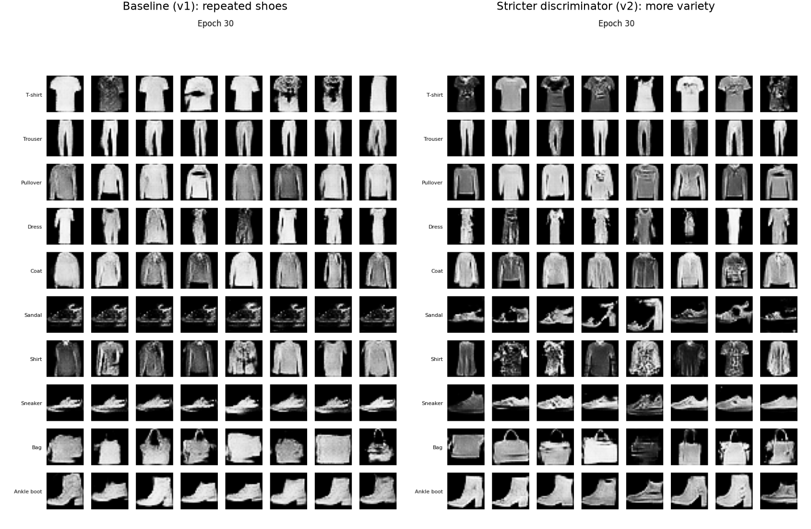
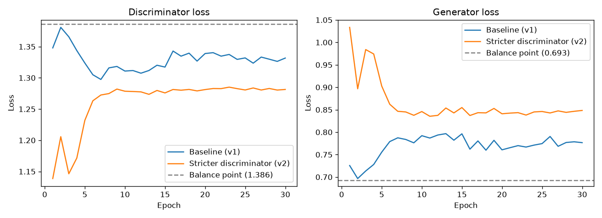

# AI Fashion Designer: Conditional GAN on Fashion-MNIST

A conditional GAN (cGAN) built with TensorFlow/Keras that draws clothing images **on command**. Ask for a "sneaker" or a "coat" and it generates a brand-new 28×28 image of that type.

I trained a baseline, found **mode collapse** in the shoe classes, and tested a fix (a stricter discriminator).

## Results

**Baseline vs. stricter discriminator, after 30 epochs** (each row is one clothing class):



The baseline (left) repeats nearly the same shoe in the Sandal and Sneaker rows. The stricter-discriminator version (right) produces varied sandals, heels, boots and sneakers.

**Loss curves:**



## How it works

A GAN has two networks that compete:

- **Generator:** takes random noise (100 numbers) and a class label, and draws an image.
- **Discriminator:** takes an image and a label, and decides if the image is a real example of that class.

The generator improves by trying to fool the discriminator, and the discriminator improves by catching the fakes.

**"Conditional"** means the label goes into both networks, so we choose what gets generated, and the discriminator can catch a picture that doesn't match its label.

**Generator:** noise + label embedding → Dense → reshape to 7×7 → two transposed convolutions (7→14→28) → `tanh` output (28×28×1)

**Discriminator:** image + label (turned into an extra image channel) → strided convolutions with LeakyReLU and Dropout → one score (logit)

**Training setup:** Binary Cross-Entropy (from logits), Adam optimizer (learning rate 0.0002, beta_1 0.5), batch size 128, 30 epochs, images scaled to the range -1 to 1.

## Experiment: fixing mode collapse

1. **Baseline (v1):** after 30 epochs, most clothing classes were varied, but the Sandal and Sneaker rows (and mostly the Ankle boot row) repeated almost the same image. This is called mode collapse.
2. **Training longer:** 30 more epochs on the baseline did not visibly reduce the repetition, and the losses had stopped changing.
3. **Hypothesis:** the discriminator was too easy to fool (its loss stayed close to 1.386, the value of pure guessing), so the generator had no reason to explore.
4. **Fix (v2):** one extra convolution layer in the discriminator and Dropout lowered from 0.3 to 0.2. Everything else stayed the same.
5. **Result:** the shoe rows became clearly more varied. The cost: some Shirt and T-shirt images became noisier.

| | Baseline (v1) | Stricter discriminator (v2) |
|---|---|---|
| Discriminator loss (steady) | about 1.33 | about 1.28 |
| Generator loss (steady) | about 0.78 | about 0.84 |

In a GAN the two losses compete, so they are not both expected to go down. A healthy balance sits near 1.386 (discriminator) and 0.693 (generator).

## Project structure

```
Fashion_GAN/
├── src/
│   ├── fashion_gan.py        # baseline model + training
│   ├── fashion_gan_v2.py     # stricter discriminator version
│   ├── plot_losses.py        # loss comparison chart
│   ├── compare_grids.py      # side-by-side grid image
│   └── learning_steps/       # small scripts used to build the project step by step
├── outputs/                  # baseline sample grids and losses
├── outputs_v2/               # v2 sample grids and losses
├── models/                   # baseline trained generator
├── models_v2/                # v2 trained generator
├── comparison/               # comparison images used in this README
└── requirements.txt
```

## How to run

```bash
pip install -r requirements.txt
python src/fashion_gan.py        # baseline
python src/fashion_gan_v2.py     # stricter discriminator
python src/plot_losses.py        # loss chart
python src/compare_grids.py      # side-by-side grids
```

**Important notes:**
- Training on a CPU is slow (about 6 to 7 minutes per epoch on my laptop). I trained on a free **Google Colab T4 GPU** (about 30 seconds per epoch).
- Running a training script overwrites the existing results in its output folders.
- Fashion-MNIST downloads automatically the first time.

## Limitations

- Each version was trained **once**. GAN training involves luck, so a second run could look different.
- The two grids use different random noise, so they compare the variety within each row, not individual images.
- Quality was judged by eye. I did not compute a numeric score such as FID.
- Images are only 28×28 grayscale.

## What I learned

- How the generator and discriminator compete, and what conditioning adds
- Why GAN losses should stay balanced and not go toward zero
- How to recognise mode collapse and test a hypothesis for fixing it
- How to move a training job from a CPU laptop to a Colab GPU